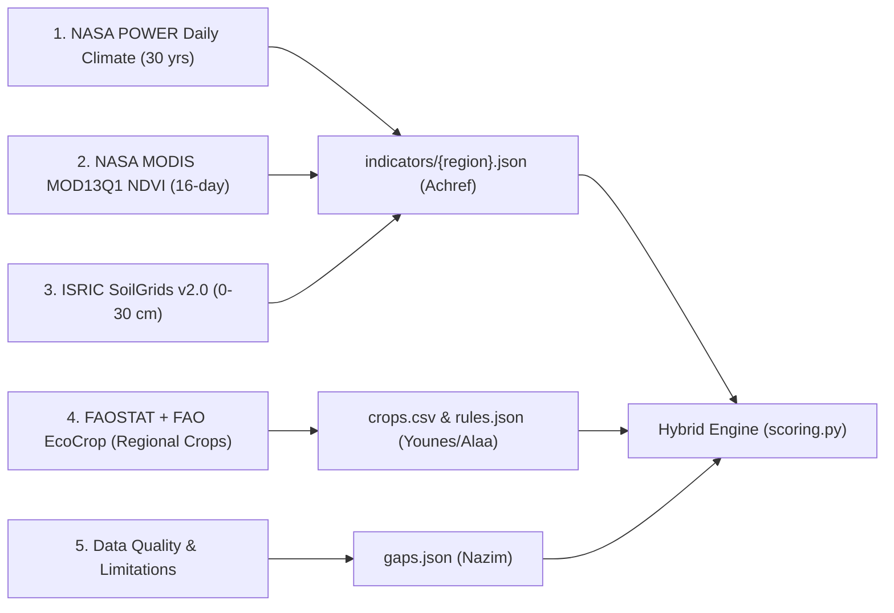
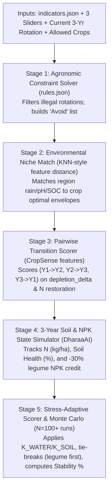

# 🧠 The Computer Scientist's Guide to Agronomy, NASA Data & Hybrid ML Rotation Engines

This guide is written specifically for software engineers and computer scientists working on **Field Shift (NASA Space Apps Challenge 2026)**. It keeps all core agronomy/satellite terms, documents why the cloned repo datasets (`CropSense` and `DharaaAI`) **do not match your region**, lists the **exact datasets to collect for Algeria/North Africa**, explains **how each dataset is processed and used in code**, and aligns the **Hybrid Engine architecture** with your team plan (`Alaa`, `Achref`, `Younes`, `Nazim`, `Mehdi`).

---

## ⚠️ Repo Data Audit: Do `CropSense` & `DharaaAI` Match Your Region?

**Short answer: NO.** Both cloned repositories were built for **Indian / tropical monsoon agriculture**, not **North African / Mediterranean semi-arid cereal-legume rotations** (e.g., Setif, Tiaret, Mitidja).

| Dimension | Cloned Repos (`CropSense` & `DharaaAI`) | Your Region (`Field Shift`: Algeria / Mediterranean) | What to Reuse vs. Replace |
| :--- | :--- | :--- | :--- |
| **Crops** | `CropSense` (`Crop_recommendation.csv`, 2,200 rows) has 22 crops: `rice`, `jute`, `coconut`, `coffee`, `papaya`, `mango`, `pigeonpeas`, `mungbean`, `mothbeans`, etc. **Zero `wheat` and zero `barley`.** | Winter rainfed **cereals** (`durum wheat`, `barley`, `oats`), **legumes** (`chickpea`, `lentil`, `faba bean`), and **oilseeds** (`canola`, `sunflower`). | **Replace crop rows completely** using FAOSTAT + FAO EcoCrop. **Reuse only the column concepts** (`nitrogen_fixer`, `soil_depletion_index`, `drought_tolerance`). |
| **Climate** | Tropical/monsoon: median `25.6 °C` (up to `43.7 °C`), median humidity `80.5%`, summer monsoon rain. | Mediterranean semi-arid: cool winters with **frost days (`< 0 °C`)**, spring grain-filling heat waves (`> 35 °C`), `300–650 mm` winter/spring rain. | **Replace climate data** with 30-year **NASA POWER** daily time series for your target coordinates. |
| **Soil pH & Chemistry** | Median `pH 6.43` (slightly acidic), assumes lab-measured field `N, P, K (kg/ha)` as user input. | Calcareous/alkaline soils (`pH 7.5–8.2`), low `SOC` (`< 10–15 g/kg`). **NASA POWER & SoilGrids do NOT provide field `N, P, K` in `kg/ha`.** | **Do not feed NASA/SoilGrids into `CropSense`'s `.pkl` models.** Fetch `soc` and `phh2o` from **ISRIC SoilGrids v2.0**. |
| **ML & Labels** | `CropSense`'s Random Forest (`F1 = 0.92`) was trained on 484 crop pairs **labelled by hand-written rules** (not real field trials). | `Field Shift` compares **3-year rotations** against the farmer's usual rotation with explainability and **Monte Carlo uncertainty**. | **Never load `.pkl` files** (security + `sklearn` mismatch) and **never claim `0.92` as real-world accuracy**. Reuse only the **tag logic** and **3-year trajectory UI**. |

> [!NOTE]
> **Two Core ML / Statistics Concepts Explained for CS:**
> - **What is `F1 = 0.92`?** The **F1-score** (`0.0` to `1.0`) is the harmonic mean of **Precision** (*of all crops predicted as "good", how many were actually right?*) and **Recall** (*of all truly "good" crops, how many did the model find?*): $F_1 = \frac{2 \times \text{Precision} \times \text{Recall}}{\text{Precision} + \text{Recall}}$. A high F1 (`0.92`) normally looks impressive, **but only measures agreement with the training labels**. Because `CropSense` generated its 484 labels using a rule script rather than real farm harvests, `F1 = 0.92` only means the Random Forest learned to imitate that script—**not** 92% real-world yield accuracy!
> - **What is Monte Carlo Uncertainty (`ranking_stability_pct`)?** Instead of running the scoring formula once on exact static rainfall (`380 mm`), **Monte Carlo simulation** runs the exact same engine **100 to 500 times**, adding random realistic weather noise each run (e.g., rainfall varies `±10–15%` each simulated year). We then count the exact percentage of runs where **Rank 1 stays Rank 1** (e.g., `"Rank 1 stays first in 87% of runs"`). Think of it as **fuzz-testing / chaos-testing** your ranking pipeline against noisy weather inputs!

---

## Part 1: Agronomy & Satellite Glossary for Computer Scientists

Think of a farm field as a **stateful server with a battery (`Soil Nitrogen & Carbon`), a cooling/power budget (`Water/Rainfall`), and security vulnerabilities (`Pests & Root Diseases`)**. Every crop is a workload you schedule for 1 year.

### 1.1 Satellite & Climate Terms (NASA Data)

| Term | Plain Definition | CS / Systems Analogy | Range & Units |
| :--- | :--- | :--- | :--- |
| **NDVI** (*Normalized Difference Vegetation Index*) | Satellite measure of how green and dense plant leaves are, computed from Near-Infrared (`NIR`) and Red light: $\text{NDVI} = \frac{\text{NIR} - \text{Red}}{\text{NIR} + \text{Red}}$. Healthy green leaves reflect `NIR` and absorb `Red`. | **Server CPU/Throughput Utilization** measured from outside via telemetry. High peak `NDVI` in spring means crops in that pixel grew vigorously. | `-1.0` to `+1.0` (`< 0.2` bare soil; `0.3–0.5` sparse crop; `0.6–0.85` dense healthy crop) |
| **Evapotranspiration (`ET0` / `ETc`)** | Simply put: **total water leaving the field into the air** each day. It combines **Evaporation (`E`)** (water drying straight out of warm soil, like a puddle drying in the sun) + **Transpiration (`T`)** (water the plant drinks through its roots and "sweats" out through its leaves to stay cool). **`ET0`** is the baseline daily water loss of standard short green grass in that weather (sun + heat + wind + dry air); **`ETc`** is your specific crop's need (`ETc = ET0 × Kc`), e.g. sunflower drinks much more than barley. | **Total System Power Draw / Battery Drain Rate.** Think of **Rainfall** as money deposited into your soil bank account, and **`ETc`** as daily cash withdrawals. Even if `380 mm` falls, high `ET` drains moisture before roots can use it. | `mm/day` or `mm/season` (`ETc`: `300–450 mm` barley, `350–500 mm` wheat, `600–1000 mm` sunflower) |
| **Water Stress Index** | `1 - (recent_avg_rainfall / reference_20yr_rainfall)`, floored at `0`: $\text{clamp}\!\left(\frac{\text{Rain}_{\text{ref}} - \text{Rain}}{\text{Rain}_{\text{ref}}},\, 0,\, 1\right)$. | **Memory/Resource Pressure (`0%` = plenty of RAM, `100%` = OOM throttling).** High water stress boosts the weight of low-thirst crops. | `0.0` (no stress) to `1.0` (severe drought stress) |
| **Hot Days (`>35 °C`)** | Annual count of days where maximum air temperature (`T2M_MAX`) exceeds `35 °C`. During spring **grain filling** (when wheat kernels fill with starch), `>35 °C` shuts down plant enzymes and shrivels the harvest. | **Thermal Throttling during a critical write operation.** | `days/year` |
| **Frost Days (`<0 °C`)** | Annual count of days where minimum air temperature (`T2M_MIN`) drops below freezing. Late spring frost kills delicate flowers on legumes (chickpea, lentil, faba bean). | **Sudden power brownout during boot.** | `days/year` |
| **Longest Dry Spell & `PRECTOTCORR`** | Maximum consecutive days with `< 1 mm` of rain (`PRECTOTCORR < 1.0`). **`PRECTOTCORR`** is the standard variable name from **NASA POWER** (*Prediction Of Worldwide Energy Resources*), representing **bias-corrected total daily precipitation** in `mm/day`. | **Longest network outage window** the crop's root buffer must survive without rain packets arriving. | `consecutive days` (`PRECTOTCORR` in `mm/day`) |
| **Mann-Kendall & Sen's Slope (`Trend Confidence`)** | Two statistical tests on 30-year climate series: Ordinary Least Squares (parametric line fit) vs. Mann-Kendall/Sen's Slope (non-parametric rank test robust to outliers). When both show `p < 0.05` with the same sign, we show `"both methods agree"`; otherwise `"no clear trend"`. | **Consensus check between two independent anomaly detectors** before firing an alert. (`p-value` = probability the trend appeared by random chance). | `mm/decade` + confidence label |

---

### 1.2 Soil Chemistry & Nutrient Terms (`SoilGrids` & `DharaaAI`)

| Term | Plain Definition | CS / Systems Analogy | Range & Units |
| :--- | :--- | :--- | :--- |
| **SOC** (*Soil Organic Carbon*) | Carbon stored in decaying plant roots, stubble, and microbes in the top `0–30 cm` of soil. Holds water like a sponge and feeds soil microbes. | **Disk Cache + UPS Battery Capacity.** Low `SOC` (`< 10 g/kg`) means rain runs off the surface instead of soaking in. | `g/kg` (`SoilGrids` reports `dg/kg`, so divide by `10`; `10 g/kg = 1%` carbon) |
| **SOM** (*Soil Organic Matter*) | Total organic matter in soil. Roughly $\text{SOM} \approx 1.724 \times \text{SOC}$ (the van Bemmelen factor). | **Total allocated storage** vs. raw payload (`SOC`). Never mix the two without converting. | `%` or `g/kg` |
| **250 m Soil Estimate** | A modelled spatial average for a `250 m × 250 m` grid cell from global machine learning (`SoilGrids`), **not** a physical lab measurement of one farmer's field. | **Cluster-level telemetry average**, not a single-container probe. Always disclose this in `gaps.json`! | `250 m` pixel |
| **N, P, K** (*Nitrogen, Phosphorus, Potassium*) | The 3 macro-nutrients every plant consumes: **N** builds green leaves/protein, **P** builds roots/flowers/seeds, **K** regulates water and disease resistance. | **CPU (`N`), Disk I/O (`P`), and Network Bandwidth (`K`).** If any one hits zero, crop growth halts (*Liebig's Law of the Minimum*). | `kg/ha` (or `mg/kg`) |
| **Fertilizer Codes (`NPK 10:26:26`, `DAP`, `MOP`, `Urea`)** | Commercial bags of synthetic nutrients. `NPK 10:26:26` is `10% N, 26% P, 26% K`. `DAP` (Diammonium Phosphate) is `18% N, 46% P`. `MOP` is Potassium (`0:0:60`). `Urea` is concentrated Nitrogen (`46% N`). | **Paid cloud burst capacity.** Expensive in cash and energy; legumes reduce how much `Urea`/`NPK` a farmer must buy (`-30%` next season). | `kg/ha` applied |
| **Soil `pH` (`phh2o`)** | Acidity (`< 6.0`), neutrality (`6.5–7.5`), or alkalinity (`> 7.8`, common in North African calcareous soils). Extreme `pH` chemically locks up Phosphorus and iron so roots cannot absorb them. | **File permission / protocol mismatch:** the data (`P`) is on disk, but the process can't read it outside `pH 6.0–7.8`. | `3.0–10.0` (`SoilGrids` reports `pH × 10`, so `79 = pH 7.9`) |

---

### 1.3 Crop Families & Rotation Mechanics

| Term | Plain Definition | CS / Systems Analogy | Examples |
| :--- | :--- | :--- | :--- |
| **Botanical Family (`family`)** | Taxonomic group sharing root structure, nutrient appetite, and pests/fungi. | **OS / Runtime Family.** Running two crops from the same family back-to-back lets family-specific malware (fungi, root worms, parasitic weeds) multiply exponentially. | `cereal` (*Poaceae*), `legume` (*Fabaceae*), `oilseed` (*Brassicaceae* / *Asteraceae*) |
| **Cereals (Grains)** | Grass-family crops grown for starch grain and straw. Provide dependable yield and high **residue carbon** (stubble), but consume soil nitrogen. | **Steady production worker nodes** that consume battery (`N`) but leave good logs/mulch (`residue_carbon`). | Durum wheat, barley, oats |
| **Legumes (Pulses)** | Bean/pea-family crops whose roots host *Rhizobium* bacteria inside nodules that pull Nitrogen gas ($N_2$) from the air and turn it into natural soil fertilizer (`+20` to `+40 kg N/ha`). | **Solar charger / garbage collector** that recharges the soil `N` battery for next year's cereal crop. | Chickpea, lentil, faba bean |
| **Oilseeds (Break Crops)** | Broadleaf crops pressed for oil (`sunflower`, `rapeseed/canola`). Deep taproots break compacted soil layers and interrupt cereal root diseases. | **Cache flush & disk defragmenter** between cereal runs. | Rapeseed (canola), sunflower |
| **Heavy Feeders (`soil_depletion_index >= 4`)** | Crops that strip large amounts of Nitrogen, Phosphorus, and water from the soil in a single season. | **GPU training job**—high revenue, but drains the battery (`-35` to `-50 kg N/ha`). Never run two back-to-back without a legume recharge. | Durum wheat, maize, potato |
| **Monoculture** | Planting the exact same crop (or cereal-after-cereal) every year on the same plot. | **Infinite loop with a memory leak.** Yield drops every year while fertilizer and pesticide costs climb. | `Wheat -> Wheat -> Wheat` |
| **Lodging, Shattering, Fusarium, Ascochyta, Broomrape** | Real field failure modes: **Lodging** = tall cereal stems falling flat in wind/rain (`oats`); **Shattering** = canola pods popping open before harvest; **Fusarium / Rust / Ascochyta** = fungal blights in wet springs; **Broomrape (*Orobanche*)** = parasitic weed attacking legumes/sunflower. | **Specific runtime exceptions** documented in each crop's `risk_note` (marked `"needs local review"`). | Shown in UI risk notes |

---

## Part 2: Complete Data Collection Checklist & How We Use Each Dataset



### 2.1 Dataset 1 — NASA POWER Agro-Climatology (`indicators.json`)
- **What it is:** Free global daily meteorology on a `0.5° × 0.625°` grid from NASA Langley Research Center (no API key needed).
- **Exact API URL (example for Setif `36.19°N, 5.41°E`):**
  `https://power.larc.nasa.gov/api/temporal/daily/point?parameters=PRECTOTCORR,T2M_MAX,T2M_MIN,RH2M,EVPTRNS&community=AG&longitude=5.41&latitude=36.19&start=19950101&end=20241231&format=JSON`
- **Important Data Gotcha (CS View):** Missing values are encoded as **`-999`**. Always filter `val != -999` before computing means/counts, or your averages will corrupt!
- **How we process and use every field in code:**
  - `PRECTOTCORR` (`mm/day`): Sum per year $\rightarrow$ 30-year mean `rainfall_mm`; bin by month $\rightarrow$ `monthly_rain_mm` (12-bar chart on Screen 2); fit OLS + Mann-Kendall/Sen's slope $\rightarrow$ `rainfall_trend_decade_mm` & `trend_confidence`; compute `water_stress = clamp((rain_ref - rain_recent) / rain_ref, 0, 1)` which dynamically scales the Water weight (`1 + K_WATER * water_stress`).
  - `T2M_MAX` (`°C`): Count days `> 35 °C` $\rightarrow$ `hot_days` (triggers heat-stress warning on wheat grain filling).
  - `T2M_MIN` (`°C`): Count days `< 0 °C` $\rightarrow$ `frost_days` (triggers frost-risk warning on winter chickpea/lentil).
  - `PRECTOTCORR > 20 mm`: Count $\rightarrow$ `extreme_rain_days`; consecutive `< 1 mm` $\rightarrow$ `longest_dry_spell_days`.

### 2.2 Dataset 2 — NASA MODIS `MOD13Q1` Vegetation Index (`indicators.json`)
- **What it is:** 16-day composite satellite greenness (`250 m` resolution) via **NASA AppEEARS** (`https://appeears.earthdatacloud.nasa.gov/`) or Google Earth Engine (`MODIS/061/MOD13Q1`).
- **Important Data Gotcha (CS View):** `NDVI` in raw MODIS GeoTIFF/HDF files is stored as an integer scaled by **`10000`** (`5400` = `0.54`). Also, you **must mask pixels** with **ESA WorldCover `class 40` (Cropland)** so forests, buildings, and bare rock do not pollute the farm signal.
- **How we use it in code:**
  - Extract spring peak `NDVI` (`March–May` in North Africa) for each year.
  - Normalize regional mean peak `NDVI` (`0.25–0.75` $\rightarrow$ `0.0–1.0`) as `yield_baseline` in `indicators.json` (used to contextualize regional productivity, never claimed as a parcel-level yield forecast).
  - Compute Coefficient of Variation ($CV = \sigma / \mu$) across years as historical biomass instability.

### 2.3 Dataset 3 — ISRIC SoilGrids v2.0 (`soil.json` $\rightarrow$ `indicators.json`)
- **What it is:** Global `250 m` digital soil map via REST API (`https://rest.isric.org/soilgrids/v2.0/properties/query`), implemented in [scripts/fetch_soilgrids.py](file:///Users/morsistoredz/NasaSpaceApps/scripts/fetch_soilgrids.py).
- **Properties to pull (`0-5cm`, `5-15cm`, `15-30cm`):**
  - `soc`: Soil Organic Carbon in `dg/kg` $\rightarrow$ **divide by `10`** to get `g/kg`.
  - `phh2o`: Soil pH in `pH × 10` $\rightarrow$ **divide by `10`** to get `pH`.
  - `nitrogen`: Total nitrogen (`cg/kg`) for soil baseline context (note: **not** plant-available mineral NPK).
- **How we process and use it in code:**
  - Compute the `0–30 cm` depth-weighted mean using layer thicknesses `5 : 10 : 15` (`total = 30 cm`):
    $$\text{SOC}_{0\text{–}30} = \frac{5 \cdot \text{L}_{0\text{–}5} + 10 \cdot \text{L}_{5\text{–}15} + 15 \cdot \text{L}_{15\text{–}30}}{30} \div 10$$
  - Map `soc_g_kg` to `soil_stress` (`low SOC < 10 g/kg` $\rightarrow$ `1.0`; `medium 10–20` $\rightarrow$ `0.5`; `high > 20` $\rightarrow$ `0.0`), which scales the Soil weight (`1 + K_SOIL * soil_stress`) and sets the starting `Soil Health %` in the 3-year trajectory simulator.

### 2.4 Dataset 4 — Regional Crop Table & Agronomic Rules (`crops.csv` & `rules.json`)
- **Where to source for Algeria / Mediterranean (instead of `CropSense`'s 22 Indian crops):**
  1. **FAOSTAT (`https://www.fao.org/faostat/`):** Top regional cereals (`durum wheat`, `barley`, `oats`) and legumes (`chickpea`, `lentil`, `faba bean`) + national/regional yield benchmarks.
  2. **FAO EcoCrop (`https://gaez.fao.org/` / EcoCrop DB):** Optimal temperature, rainfall (`mm`), and `pH` envelopes for each Mediterranean crop (replaces `CropSense`'s tropical `Crop_recommendation.csv` envelopes).
  3. **Local Extension Sheets (ITGC Algeria / ICARDA):** Agronomic rules (`min_legumes_in_3_years = 1`, `max_cereals_in_3_years = 2`, no consecutive same-crop/same-family) and crop-specific `risk_note` strings (`"needs local review"`).
- **Schema (`data/inputs/crops.csv`):**
  `crop, family, water_need, nitrogen_fixing, residue_carbon, drought_tolerance, profit, risk_level, soil_depletion_index, nitrogen_impact_kg_ha, soil_health_delta, base_npk_kg_ha, optimal_rain_min, optimal_rain_max, optimal_ph_min, optimal_ph_max, risk_note`
- **How we use it in code:**
  - `rules.json` filters the `n^3` combinations (`4^3 = 64` $\rightarrow$ `24` legal rotations) in **Stage 1** before any scoring happens, and populates the **"🚫 Rotations & Crops to Avoid"** panel.
  - `crops.csv` drives the marks (`water`, `soil`, `yield`), contextual tags (`🌿 Restores Nitrogen`, `💧 Low Water`), KNN environmental niche matching, and 3-year soil/NPK simulation.

### 2.5 Dataset 5 — Data Limitations & Scenario Config (`gaps.json`)
- **What it is:** Structured honesty metadata authored with `Nazim` & `Achref` (e.g., `"250 m SoilGrids cell is a regional average, not a single-field lab NPK test"`, `"NASA POWER 0.5° grid smooths local micro-valleys"`).
- **How we use it in code:** Every recommendation's `E5` explanation block pulls directly from `gaps.json` and `indicators.json` (zero hardcoded free text), ensuring transparent scientific communication for farmers and NASA judges.

---

## Part 3: Upgrading the Engine from Pure Rules to Hybrid AI/ML

> [!IMPORTANT]
> **Why Hybrid AI beats "Pure ML" or "Pure Rules" in Agronomy (and matches your Field Shift Rules):**
> - **Pure Rules** are 100% transparent and never recommend illegal rotations, but cannot score continuous climate-soil suitability or multi-year state dynamics.
> - **Pure ML** without domain rules will occasionally hallucinate an illegal rotation, and `CropSense`'s RF (`0.92`) only learned rule-generated labels.
> - **The Professional Hybrid Standard:** **Stage 1 Hard Rules** $\rightarrow$ **Stage 2 Environmental Niche Suitability (KNN-style distance)** $\rightarrow$ **Stage 3 Pairwise Transition Scoring** $\rightarrow$ **Stage 4 3-Year Soil & Fertilizer State Simulator** $\rightarrow$ **Stage 5 Stress-Adaptive Scoring & Monte Carlo Stability**.



### Alignment with Your Team's Build Order (`E1–E8`)
1. **`E1` Validation:** Verify all crop names match `crops.csv`, all metrics are in `[0, 100]`, and sliders are not all zero.
2. **`E2` Candidate Generation & Rules (`Stage 1`):** Generate all 3-year permutations (`product(allowed_crops, repeat=3)`), filter via `rules.json`, and record blocked rotations/crops for the UI warning list.
3. **`E3–E4` Marks, Stress-Adaptive Weights & Deterministic Tie-Breaker:**
   - Adjust slider weights by `(1 + K_WATER * water_stress)` and `(1 + K_SOIL * soil_stress)`, re-normalize to sum to `1.0`.
   - Group by `frozenset(rot)` (best order per distinct crop set), tie-break deterministically (**legume in Year 1 first, then alphabetical**), and always include the farmer's **Usual Rotation** (unfiltered) for comparison.
4. **`E5` Data-Driven Explanations + Contextual Tags:** Populate `why`, `evidence`, `benefits` (`🌿 Restores Nitrogen`, `💧 Low Water`, `☀️ Drought Tolerant`), `gaps` (from `gaps.json`), and `risks` (from `crops.csv` `risk_note`).
5. **`E6–E8` API, Tests & Monte Carlo Stability:** Expose JSON to FastAPI/HTML UI, verify against hand calculations in `logs/test_log.md`, and run `N=100+` rainfall perturbations (`±10–15%`) so `ranking_stability_pct` is **always computed live, never hardcoded**.

---

## Part 4: APIs Needed, Best Tools & Production Code Examples

### 4.1 All External APIs You Need (Role, What They Return, Auth & Gotchas)

| API / Platform | Role in `Field Shift` | Variables Requested | What It Adds to Your Project (`Output`) | Auth & Rate Limit | Critical Gotchas |
| :--- | :--- | :--- | :--- | :--- | :--- |
| **1. NASA POWER REST API**<br>`power.larc.nasa.gov/api/temporal/daily/point` | **30-Year Historical Weather & Climate Trends** (`1995–2024`) | `PRECTOTCORR` (bias-corrected rain, `mm/day`), `T2M_MAX`, `T2M_MIN`, `RH2M`, `EVPTRNS` / `ALLSKY_SFC_SW_DWN` | Fills `rainfall_mm`, `water_stress`, `monthly_rain_mm` (12 bars), `hot_days`, `frost_days`, `longest_dry_spell_days`, `rainfall_trend_decade_mm`, and `trend_confidence` (`Mann-Kendall vs OLS`). | **Free, No API Key.** Keep requests polite (`1–2 sec` pause between regions). | Missing values are encoded as **`-999`** (always filter them out!). Resolution is `0.5° × 0.625°` (~`55 km`), so it smooths local valleys. |
| **2. NASA AppEEARS API** (`appeears.earthdatacloud.nasa.gov/api`) **OR Google Earth Engine (`earthengine-api`)** | **Satellite Crop Greenness / Yield Baseline** (`MODIS MOD13Q1`, `250 m`, 16-day) | `_250m_16_days_NDVI`, `pixel_reliability` QA band + **ESA WorldCover `class 40`** (Cropland mask) | Fills `yield_baseline` (`0–1` normalized spring peak NDVI) and multi-year yield instability (`CV = std / mean`). | Free **NASA Earthdata Login** (AppEEARS) or free non-commercial **GEE project**. | Raw MODIS NDVI integers are scaled by **`10000`** (`5400 = 0.54`). Always mask non-cropland pixels (`WorldCover class 40`) before averaging! |
| **3. ISRIC SoilGrids v2.0 REST API**<br>`rest.isric.org/soilgrids/v2.0/properties/query` | **Regional Topsoil Chemistry (`0–30 cm`)** | `soc` (`dg/kg`), `phh2o` (`pH × 10`), `nitrogen` (`cg/kg`), `clay` / `sand` (`g/kg`) | Fills `soil.json` $\rightarrow$ `soil_organic_carbon_g_per_kg`, `soil_stress`, `ph`, and starting `Soil Health %` in the 3-year state simulator. | **Free, No API Key.** Rate-limited (~5 req/min). | Frequently returns HTTP `503` under load! **Always cache JSON to disk**, use exponential retry, and divide `soc` & `phh2o` by **`10`**. Remember it is a `250 m` model estimate, not a lab NPK test. |
| **4. Open-Meteo Forecast API** *(Optional Live Extension)*<br>`api.open-meteo.com/v1/forecast` | **Live 7–16 Day Forecast & Daily Reference ET₀** | `precipitation_sum`, `et0_fao_evapotranspiration`, `temperature_2m_max`, `soil_moisture_0_to_7cm` | Adds real-time current-week rain & `ET0` alerts next to NASA POWER's 30-year climate baseline. | **Free, No API Key** (non-commercial). | Forecast only (use NASA POWER for 20–30 yr climatology and trends). |
| **5. Static Regional Tables (No Live API Needed)** | **Agronomy Rules & Official Prices** | FAO Paper 56 $ET_c$, ICARDA BNF, ITGC yields, **OAIC/CCLS `DA/quintal`** | `data/regional/crops_algeria.csv`, `rules_algeria.json`, `regions.json`, `gaps.json`. | **Local files (0 ms latency, 100% offline-safe).** | Update prices annually from OAIC/CCLS decrees (`needs local review`). |

---

### 4.2 Best Python & CS Tooling Stack for Your Team

| Layer | Best Tool / Library | Why CS Engineers Pick It for `Field Shift` |
| :--- | :--- | :--- |
| **Satellite / Raster (`NDVI`)** | **`earthengine-api` (`ee`)** + **`geemap`** *(or **`earthaccess`** + **`rioxarray`**)* | **Best choice for hackathons:** GEE filters 20 years of `MOD13Q1` MODIS tiles and masks `ESA WorldCover == 40` in the cloud in 15 lines—no need to download 40 GB of raw HDF rasters! |
| **HTTP Fetching & Caching** | **`httpx`** (or **`requests`** + `urllib3.Retry`) | Automatic timeouts, retries on SoilGrids `503`, and clean JSON caching into `data/processed/`. |
| **Time-Series & Climate Stats** | **`pandas`**, **`numpy`**, **`scipy.stats`**, **`pymannkendall`** | `pymannkendall.original_test(series)` computes Mann-Kendall p-value + Sen's Slope in **1 line of code** to compare against OLS regression. |
| **Hybrid ML & Optimization** | **`scikit-learn`** (`StandardScaler`, `KNeighborsClassifier`, `RandomForestRegressor`) | Train directly from clean CSV/arrays at startup (avoid insecure `.pkl` loading) + `itertools.product` for deterministic rule-constrained search. |
| **Backend API & Validation** | **`FastAPI`** + **`pydantic`** + **`uvicorn`** | Auto-generates OpenAPI docs (`/docs`) for Mehdi, validates slider weights/crops cleanly, and serves JSON directly to your frontend. |
| **Testing & Reproducibility** | **`pytest`** + deterministic seeded `random.Random(42)` | Guarantees identical rankings across runs and verifies hand calculations against `logs/test_log.md`. |

---

### 4.3 Complete Copy-Paste Code Examples

#### Example 1 — Fetch NASA POWER 30-Year Climate, Clean `-999`, & Compute Mann-Kendall Consensus (`Achref`)
```python
import numpy as np
import pandas as pd
import pymannkendall as mk
import requests
from scipy.stats import linregress

def fetch_nasa_power_indicators(lat: float, lon: float, start="19950101", end="20241231") -> dict:
    url = "https://power.larc.nasa.gov/api/temporal/daily/point"
    params = {
        "parameters": "PRECTOTCORR,T2M_MAX,T2M_MIN,RH2M",
        "community": "AG",
        "longitude": lon,
        "latitude": lat,
        "start": start,
        "end": end,
        "format": "JSON",
    }
    resp = requests.get(url, params=params, timeout=30)
    resp.raise_for_status()
    raw = resp.json()["properties"]["parameter"]

    df = pd.DataFrame(raw).replace(-999.0, np.nan).dropna()
    df.index = pd.to_datetime(df.index, format="%Y%m%d")
    df["year"] = df.index.year
    df["month"] = df.index.month

    annual_rain = df.groupby("year")["PRECTOTCORR"].sum()
    hot_days = df.groupby("year")["T2M_MAX"].apply(lambda s: (s > 35.0).sum()).mean()
    frost_days = df.groupby("year")["T2M_MIN"].apply(lambda s: (s < 0.0).sum()).mean()
    extreme_rain = df.groupby("year")["PRECTOTCORR"].apply(lambda s: (s > 20.0).sum()).mean()

    # Longest consecutive dry spell (< 1 mm/day) per year
    def max_dry_spell(series: pd.Series) -> int:
        dry = (series < 1.0).astype(int)
        groups = (dry != dry.shift()).cumsum()
        return int(dry.groupby(groups).sum().max() or 0)

    longest_dry = df.groupby("year")["PRECTOTCORR"].apply(max_dry_spell).mean()
    monthly_rain = df.groupby(["year", "month"])["PRECTOTCORR"].sum().groupby("month").mean().round(1).tolist()

    # Consensus trend test: OLS linear regression vs Mann-Kendall + Sen's slope
    ols = linregress(annual_rain.index.to_numpy(), annual_rain.to_numpy())
    mk_res = mk.original_test(annual_rain.to_numpy())
    agree = (ols.pvalue < 0.05) and (mk_res.p < 0.05) and (np.sign(ols.slope) == np.sign(mk_res.slope))

    rain_ref_20yr = float(annual_rain.iloc[:-5].mean())
    rain_recent_5yr = float(annual_rain.iloc[-5:].mean())
    water_stress = float(np.clip((rain_ref_20yr - rain_recent_5yr) / rain_ref_20yr, 0.0, 1.0))

    return {
        "rainfall_mm": round(float(annual_rain.mean()), 1),
        "rainfall_reference_mm": round(rain_ref_20yr, 1),
        "water_stress": round(water_stress, 3),
        "rainfall_trend_decade_mm": round(float(mk_res.slope * 10.0), 1),
        "trend_confidence": "both methods agree" if agree else "no clear trend",
        "hot_days": round(float(hot_days), 1),
        "frost_days": round(float(frost_days), 1),
        "extreme_rain_days": round(float(extreme_rain), 1),
        "longest_dry_spell_days": round(float(longest_dry), 1),
        "monthly_rain_mm": monthly_rain,
    }
```

#### Example 2 — Fetch MODIS `MOD13Q1` Spring Peak NDVI Masked to Cropland (`Google Earth Engine`)
```python
import ee

def fetch_cropland_ndvi_baseline(lat: float, lon: float, buffer_m: int = 15000) -> dict:
    ee.Initialize()
    aoi = ee.Geometry.Point([lon, lat]).buffer(buffer_m)

    # ESA WorldCover 10m cropland mask (class 40 = Cropland)
    cropland = ee.ImageCollection("ESA/WorldCover/v200").first().select("Map").eq(40)

    # Spring peak NDVI (March-May) for 2015-2024; raw MODIS NDVI is scaled by 10000
    modis = ee.ImageCollection("MODIS/061/MOD13Q1").filterBounds(aoi).select("NDVI")
    peaks = []
    for yr in range(2015, 2025):
        spring_max = (
            modis.filterDate(f"{yr}-03-01", f"{yr}-05-31")
            .max()
            .multiply(0.0001)
            .updateMask(cropland)
        )
        val = spring_max.reduceRegion(ee.Reducer.mean(), aoi, 250, maxPixels=1e7).get("NDVI").getInfo()
        if val is not None:
            peaks.append(float(val))

    mean_ndvi = sum(peaks) / len(peaks)
    yield_baseline = max(0.0, min(1.0, (mean_ndvi - 0.25) / (0.75 - 0.25)))
    return {"mean_spring_peak_ndvi": round(mean_ndvi, 3), "yield_baseline": round(yield_baseline, 3)}
```

#### Example 3 — Fetch ISRIC SoilGrids v2.0 `0–30 cm` with `5:10:15` Weighting & `503` Retry (`Achref`)
```python
import time
import requests

def fetch_soilgrids_topsoil(lat: float, lon: float, retries: int = 3) -> dict:
    url = "https://rest.isric.org/soilgrids/v2.0/properties/query"
    params = [
        ("lat", lat), ("lon", lon),
        ("property", "soc"), ("property", "phh2o"),
        ("depth", "0-5cm"), ("depth", "5-15cm"), ("depth", "15-30cm"),
        ("value", "mean"),
    ]
    for attempt in range(retries):
        r = requests.get(url, params=params, timeout=20)
        if r.status_code == 200:
            layers = {l["name"]: l["depths"] for l in r.json()["properties"]["layers"]}
            weights = {"0-5cm": 5, "5-15cm": 10, "15-30cm": 15}
            def weighted_mean(prop: str) -> float:
                vals = {d["label"]: d["values"]["mean"] for d in layers[prop]}
                # Convert dg/kg -> g/kg (and pH*10 -> pH) by dividing by 10
                return sum(weights[k] * vals[k] for k in weights) / 30.0 / 10.0
            return {
                "soil_organic_carbon_g_per_kg": round(weighted_mean("soc"), 2),
                "ph": round(weighted_mean("phh2o"), 2),
                "source": "ISRIC SoilGrids v2.0 live",
            }
        time.sleep(2 ** attempt)
    raise RuntimeError("SoilGrids unavailable; fall back to cached data/processed/{region}/soil.json")
```

#### Example 4 — FastAPI Endpoint + Seeded Monte Carlo Stability (`Mehdi` & `Alaa`)
```python
import random
from fastapi import FastAPI
from pydantic import BaseModel
from engine import scoring

app = FastAPI(title="Field Shift Rotation API")

class RecommendRequest(BaseModel):
    region: str = "regionA"
    priorities: dict[str, float]  # {"profit": 0.4, "water": 0.2, "soil": 0.2, "risk": 0.2}
    indicators: dict
    current_rotation: list[str]
    monte_carlo_runs: int = 500

@app.post("/recommend")
def recommend_endpoint(req: RecommendRequest):
    base = scoring.recommend(req.priorities, req.indicators, req.current_rotation)
    top1_rot = base["strategies"][1]["rotation"]  # Index 0 is "existing"

    # Monte Carlo stability: perturb rainfall +/- 15% across 500 seeded runs
    rng = random.Random(42)
    wins = 0
    for _ in range(req.monte_carlo_runs):
        noisy_ind = dict(req.indicators)
        noisy_ind["rainfall_mm"] = req.indicators["rainfall_mm"] * rng.uniform(0.85, 1.15)
        res = scoring.recommend(req.priorities, noisy_ind, req.current_rotation)
        if res["strategies"][1]["rotation"] == top1_rot:
            wins += 1

    base["ranking_stability_pct"] = round(100.0 * wins / req.monte_carlo_runs, 1)
    return base
```


---

## Part 5: Backend REST APIs We Must Create (`Field Shift API Blueprint`)

Right now, [server.py](file:///Users/morsistoredz/NasaSpaceApps/server.py) serves 3 starter routes (`GET /indicators/{region}`, `POST /recommend`, `POST /validate-crop`) using Python's built-in `ThreadingHTTPServer`, while the static web UI handles interactions in-browser. To upgrade **Field Shift** into a full multi-user production backend (for mobile apps, arbitrary GPS coordinates, saved farm plans, and PDF reports), build the following **8 REST APIs** with **FastAPI + Pydantic v2**.

### 5.1 Current vs. Target Backend Endpoints

| Method & Endpoint | Status | Role & Behavior | Request Inputs | Key Response Fields & Status Codes |
| :--- | :--- | :--- | :--- | :--- |
| **`GET /health`** | **To Create** | Health probe for uptime monitoring & load balancers; confirms dataset load & cache readiness. | None | `200 OK`: `{status, version, regions_loaded, crops_loaded, last_sync}` |
| **`GET /regions`** | **To Create** | Lists all benchmark Algerian regions (`regionA`/`setif`, `regionB`/`constantine`, `regionC`/`tiaret`) so the UI never hardcodes region dropdowns or map pins. | None | `200 OK`: `[{id, code, name, lat, lon, rainfall_mm, water_stress, soc_g_kg, ph}]` |
| **`GET /indicators/{region_id}`** | **Implemented** *(in `server.py`)* -> **Harden** | Returns cached live NASA POWER climatology, ISRIC SoilGrids `0–30 cm` soil metrics, MODIS spring peak `NDVI` `yield_baseline`, trend confidence, and suggested priorities. | Path: `region_id` (`regionA`, `regionB`, `regionC`) | `200 OK` (full region telemetry JSON); `404 Not Found` if unknown region. |
| **`POST /parcel/indicators`** | **To Create** *(High Priority)* | **Dynamic GPS Lookup:** Queries live NASA POWER + SoilGrids + MODIS for *any* arbitrary farm coordinate in Algeria (`0.1°` disk/Redis cache + `503` stale fallback). | `{lat: float, lon: float}` *(validated within Algeria bounds)* | `200 OK` (dynamic telemetry JSON); `422` if out-of-bounds; `503` if upstream APIs time out with no cache. |
| **`GET /crops`** | **To Create** | Serves the 13 calibrated Algerian crops (`crops_algeria.csv` + user custom crops) with `OAIC/CCLS` prices (`DA/q`), FAO `ETc`, and live regional compatibility status. | Optional query: `?region=regionA` | `200 OK`: `{crops: [...], count: 13}` *(annotated with `compatible` / `marginal` / `blocked` if `region` supplied)*. |
| **`POST /validate-crop`** | **Implemented** *(in `server.py`)* -> **Harden** | **Regional Compatibility Gate:** Verifies whether a farmer's custom crop fits regional rainfall (`>= 90%` of `rain_min`), SoilGrids `pH` (`±0.3`), frost days (`< 0 °C`), heat days (`> 35 °C`), and valid botanical family. | `{region, crop: {name, family, rain_min, rain_max, ph_min, ph_max, frost_tolerant, heat_tolerant}}` | `200 OK`: `{compatible, status ("compatible" \| "marginal" \| "blocked"), blockers: [], warnings: []}`; `422` on invalid numbers. |
| **`POST /recommend`** | **Implemented** *(in `server.py`)* -> **Harden** | Main hybrid engine: validates custom crops first, adjusts priority weights by `water_stress` & `soc_deficit`, scores valid 3-year cycles, runs 100–500 Monte Carlo perturbations (`ranking_stability_pct`), computes 3-yr NPK savings, and returns `rotations_to_avoid` + `gaps`/`risks`. | `{region, priorities: {save_water, protect_soil, yield}, current_rotation: [c1, c2, c3], allowed_crops?: [], custom_crops?: {}, monte_carlo_runs?: 100}` | `200 OK` (full recommendation payload); `400 Bad Request` if `current_rotation` unknown or `custom_crops` incompatible. |
| **`POST /scenario`** | **To Create** | **Climate What-If Stress Test:** Re-runs `scoring.scenario()` under farmer-selected drought (`rainfall_delta_pct`, e.g. `-20%`) and warming (`temp_delta_c`, e.g. `+2.0 °C`) shifts and returns baseline vs. stressed rankings. | `{region, priorities, current_rotation, rainfall_delta_pct, temp_delta_c}` | `200 OK`: `{baseline, scenario, ranking_changed: bool, shifted_rainfall_mm, shifted_water_stress}` |
| **`POST /plans` & `GET /plans/{farm_id}`** *(Phase 2)* | **To Create** | Saves chosen 3-year rotations & farmer custom crops into **SQLite / PostgreSQL** (replacing browser-only `localStorage`) and exports printable FR/AR PDF reports (`GET /reports/{plan_id}.pdf`). | `{farm_id, region, chosen_rotation, custom_crops, notes}` | `201 Created` (`POST`), `200 OK` (`GET`), `404` if `plan_id` missing. |

---

### 5.2 Non-Functional API Requirements (What CS Engineers Must Wire)

1. **Schema Validation (`Pydantic v2`):** Reject negative rainfall, `pH < 3.5` or `> 9.5`, rotations with `len != 3`, or coordinates outside Algeria (`lat 18.9–37.2`, `lon -8.7–12.0`) with automatic HTTP `422`.
2. **CORS Middleware:** Allow requests from `https://field-shift-crop-advisor.netlify.app` and `http://127.0.0.1:*` so the web frontend and local mobile emulators can call FastAPI directly without browser CORS errors.
3. **Cache-First External Fetches + Stale Fallback:** Round `{lat, lon}` to `0.1°` (~11 km grid) before querying NASA POWER / SoilGrids, cache results for **7–30 days** on disk/Redis, and fall back to cached regional JSON if an external NASA/ISRIC server returns `503`.
4. **Rate Limiting & Determinism:** Cap `monte_carlo_runs <= 1000` per request so a single client cannot freeze CPU workers, and always seed Monte Carlo (`random.Random(42)`) + tie-break (`legume` Year 1 -> alphabetical) so API responses are **100% reproducible**.

---

### 5.3 Copy-Paste FastAPI Production Router (`api/main.py`)

```python
from fastapi import FastAPI, HTTPException
from fastapi.middleware.cors import CORSMiddleware
from pydantic import BaseModel, Field
from pathlib import Path
import json

from engine import scoring

app = FastAPI(title="Field Shift Crop Rotation API", version="2.0.0")
app.add_middleware(
    CORSMiddleware,
    allow_origins=["https://field-shift-crop-advisor.netlify.app", "http://127.0.0.1:8000"],
    allow_methods=["*"],
    allow_headers=["*"],
)

INDICATORS = json.loads(Path("data/regional/all_indicators.json").read_text(encoding="utf-8"))

class Priorities(BaseModel):
    save_water: float = Field(42, ge=0, le=100)
    protect_soil: float = Field(33, ge=0, le=100)
    yield_stab: float = Field(25, ge=0, le=100, alias="yield")

class CropSpec(BaseModel):
    family: str
    rain_min: float = Field(ge=0, le=4000)
    rain_max: float = Field(ge=0, le=4000)
    ph_min: float = Field(6.0, ge=3.5, le=9.5)
    ph_max: float = Field(8.2, ge=3.5, le=9.5)
    frost_tolerant: int = Field(1, ge=0, le=1)
    heat_tolerant: int = Field(1, ge=0, le=1)

class ValidateCropReq(BaseModel):
    region: str = "regionA"
    crop: CropSpec

class ScenarioReq(BaseModel):
    region: str = "regionA"
    priorities: Priorities
    current_rotation: list[str] = Field(min_length=3, max_length=3)
    rainfall_delta_pct: float = Field(-20, ge=-60, le=40)

@app.get("/health")
def health():
    data = scoring.load_data()
    return {"status": "ok", "regions_loaded": len(INDICATORS), "crops_loaded": len(data["crops"])}

@app.get("/regions")
def list_regions():
    return [
        {"id": k, "label": v["label"], "rainfall_mm": v["rainfall_mm"], "ph": v["ph"], "water_stress": v["water_stress"]}
        for k, v in INDICATORS.items()
    ]

@app.get("/indicators/{region_id}")
def get_indicators(region_id: str):
    if region_id not in INDICATORS:
        raise HTTPException(status_code=404, detail=f"Unknown region '{region_id}'")
    return INDICATORS[region_id]

@app.get("/crops")
def list_crops(region: str | None = None):
    crops = scoring.load_data()["crops"]
    ind = INDICATORS.get(region) if region else None
    out = []
    for name, c in crops.items():
        row = {"id": name, **c}
        if ind:
            row["compatibility"] = scoring.check_crop_compatibility(c, ind)
        out.append(row)
    return {"count": len(out), "crops": out}

@app.post("/validate-crop")
def validate_crop(req: ValidateCropReq):
    ind = INDICATORS.get(req.region)
    if not ind:
        raise HTTPException(status_code=404, detail=f"Unknown region '{req.region}'")
    return {"region": req.region, **scoring.check_crop_compatibility(req.crop.model_dump(), ind)}

@app.post("/scenario")
def run_scenario(req: ScenarioReq):
    ind = INDICATORS.get(req.region)
    if not ind:
        raise HTTPException(status_code=404, detail=f"Unknown region '{req.region}'")
    tot = max(1.0, req.priorities.save_water + req.priorities.protect_soil + req.priorities.yield_stab)
    weights = {
        "water": req.priorities.save_water / tot,
        "soil": req.priorities.protect_soil / tot,
        "profit": req.priorities.yield_stab / (2 * tot),
        "risk": req.priorities.yield_stab / (2 * tot),
    }
    return scoring.scenario(weights, ind, req.current_rotation, req.rainfall_delta_pct)
```
